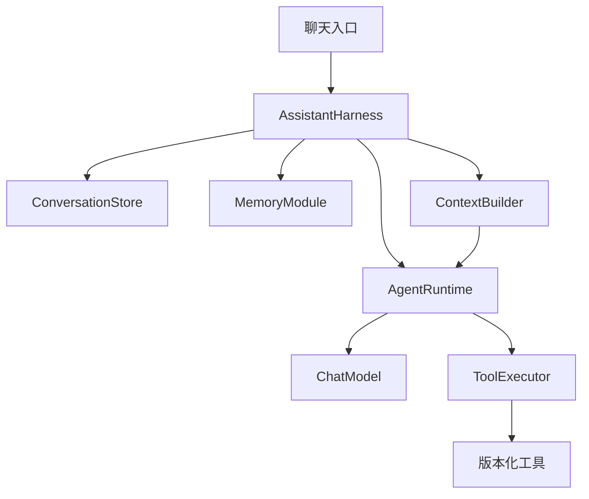

# Personal Assistant

Java 21 + Spring Boot + Spring AI 的个人助手。固定 ReAct / Harness 主链路，模型、工具、记忆、上下文与存储通过组件插入；版本由发布清单固定。

## 启动

```bash
mvn -DskipTests package
mvn spring-boot:run
```

打开 http://127.0.0.1:18081/ 。默认使用本地确定性演示模型，无需 API Key、MySQL 或 Redis。

可尝试“你好”“现在几点”“寻找 Java 学习视频”，或先发送“记住：我喜欢中文回答”，再询问“你记得什么”。

演示模型用于检查调用链，不具备真实大模型的自由对话能力。视频示例只生成平台搜索入口，不检索、验证或下载资源。

## 版本管理

默认清单：[baseline-v1.yml](src/main/resources/releases/baseline-v1.yml)。

它固定提示词版本及校验和、上下文/记忆/存储/执行器版本、工具名称与版本，以及上下文和调用预算。另有 [compact-v1.yml](src/main/resources/releases/compact-v1.yml)，使用相同组件实现并减少历史上下文，用于比较配置。

切换版本组合：

```bash
ASSISTANT_RELEASE=classpath:releases/compact-v1.yml mvn spring-boot:run
```

也支持 `ASSISTANT_RELEASE=file:/绝对路径/my-release.yml`。重启后生效，不默认选择 latest。

每轮对话保存实际装配的 `manifest`，包括：

- 发布清单 ID、组件版本和实现类指纹；
- 提示词完整内容、版本及 SHA-256；
- 启用工具的版本、描述、输入 Schema 和实现指纹；
- 上下文/模型/预算参数、自定义组件声明的脱敏参数；
- 整份配置快照的 fingerprint。

聊天响应带 `releaseId` 与 `configurationId`；`GET /api/components` 可查看当前快照。API Key 和带凭据的端点地址不会自动写入快照。

新增版本时保留旧文件，复制清单再调整引用；升级组件逻辑时保留旧实现。完整流程见 [版本更新指南](docs/VERSIONING.md)。

## 固定骨架与组件



| 位置 | 职责 |
| --- | --- |
| `core/AgentRuntime` | 模型与工具循环、执行预算、工具意图检查点 |
| `core/AssistantHarness` | 会话串行、恢复、持久化、失败收口与记忆调用 |
| `port/` | 组件稳定契约 |
| `component/` | 默认组件实现 |
| `extension/`（按需创建） | 自定义组件与工具 Bean |
| `versioning/` | 组件版本声明、快照格式和指纹 |
| `config/` | 按清单装配、版本一致性检查 |
| `resources/releases/` | 版本组合及行为参数 |
| `resources/prompts/assistant/v1.txt` | assistant@1.0.0 提示词 |

核心循环不解释业务工具名或组件版本。用户 Bean 替换对应默认组件，启动时核对实现版本与清单一致。工具支持同时注册多个实现版本，再按清单选择其中一个。

开发示例见 [组件开发指南](docs/COMPONENTS.md)。

## 接入真实模型

```bash
export ASSISTANT_MODEL_PROVIDER=openai
export AI_API_KEY='填写服务商密钥'
export AI_BASE_URL='填写服务商地址，例如 https://api.example.com'
export AI_COMPLETIONS_PATH='/v1/chat/completions'
export AI_MODEL='填写支持工具调用的模型名称'
mvn spring-boot:run
```

最终请求地址由 `AI_BASE_URL + AI_COMPLETIONS_PATH` 组成，按服务商实际设置，避免重复拼接 `/v1`。

模型适配器记录自己的版本，模型名称记录在运行快照中。模型默认连接与响应超时 60 秒，不自动重试。真实模型调用未在此次版本化检查中执行。

## 数据与配置

入口与模型连接配置见 [application.yml](src/main/resources/application.yml)，行为配置见所选发布清单。

| 环境变量 | 默认值 |
| --- | --- |
| `ASSISTANT_RELEASE` | `classpath:releases/baseline-v1.yml` |
| `ASSISTANT_PORT` | `18081` |
| `ASSISTANT_DATA_DIR` | `./data`，相对于启动目录 |
| `ASSISTANT_MODEL_PROVIDER` | `demo` |
| `ASSISTANT_MEMORY` | `notes`，可选 `none` |
| `ASSISTANT_SYSTEM_PROMPT` | 清单指定的 classpath 资源 |
| `ASSISTANT_PROMPT_SHA256` | 清单固定的提示词内容校验和 |

默认备注记忆只保存以“记住：”或“记住:”开头的消息，按 conversationId 隔离。新对话不读取其他会话备注。关闭长期记忆不删除聊天记录：

```bash
ASSISTANT_MEMORY=none mvn spring-boot:run
```

`data/conversations/` 保存聊天、工具检查点与版本快照，`data/memory/` 保存显式备注。数据目录已加入 Git 忽略规则。替换记忆实现时，旧数据格式不会自动迁移。

默认上下文最多选择最近 8 个完整成功轮次，历史 24000 字符、记忆 4000 字符。运行消息总上限 64000 字符，每轮最多 12 次模型调用。字符数属于近似预算，未计入服务商协议和工具定义开销。

## HTTP API

```bash
curl http://127.0.0.1:18081/api/chat \
  -H 'Content-Type: application/json' \
  -d '{"conversationId":"my-chat","message":"现在几点"}'

curl http://127.0.0.1:18081/api/conversations/my-chat
curl http://127.0.0.1:18081/api/components
```

聊天返回 `conversationId、turnId、answer、modelCalls、warnings、releaseId、configurationId`。记忆故障不会回滚已保存的回答。

## 恢复与边界

- 单轮状态为 `RUNNING → COMPLETED / FAILED`，检查点保留该轮最初的版本快照。
- 工具意图保存成功后才执行；重启后的未完成轮次保留为失败记录，不自动重放。
- 成功轮次恢复完整工具配对；上下文裁剪不删除原始记录。
- schemaVersion=1 的旧记录继续可读，manifest 为 null；新记录使用 schemaVersion=2，要求存在快照。
- 当前为单进程、同一会话串行、本地原子文件替换；两个进程不能共用数据目录。
- 默认仅监听 127.0.0.1。身份授权、SSE、跨会话记忆、后台任务和动态热加载尚未实现。
- 配置指纹用于定位版本与参数差异，不保证真实模型和外部工具结果逐字复现。

详见 [架构](docs/ARCHITECTURE.md) 与 [后续事项](docs/ISSUES.md)。

## 轻量检查

默认只做编译和与本次变动有关的小检查，不启动浏览器或访问外部模型。

```bash
mvn -DskipTests compile
mvn -Dtest=VersioningTest test
```

已有其他测试保留为按需入口，不默认执行完整测试集。

项目固定使用 Spring AI 1.1.8；[手动工具执行文档](https://docs.spring.io/spring-ai/reference/1.1/api/tools.html#_user_controlled_tool_execution) 是模型工具协议参考。
