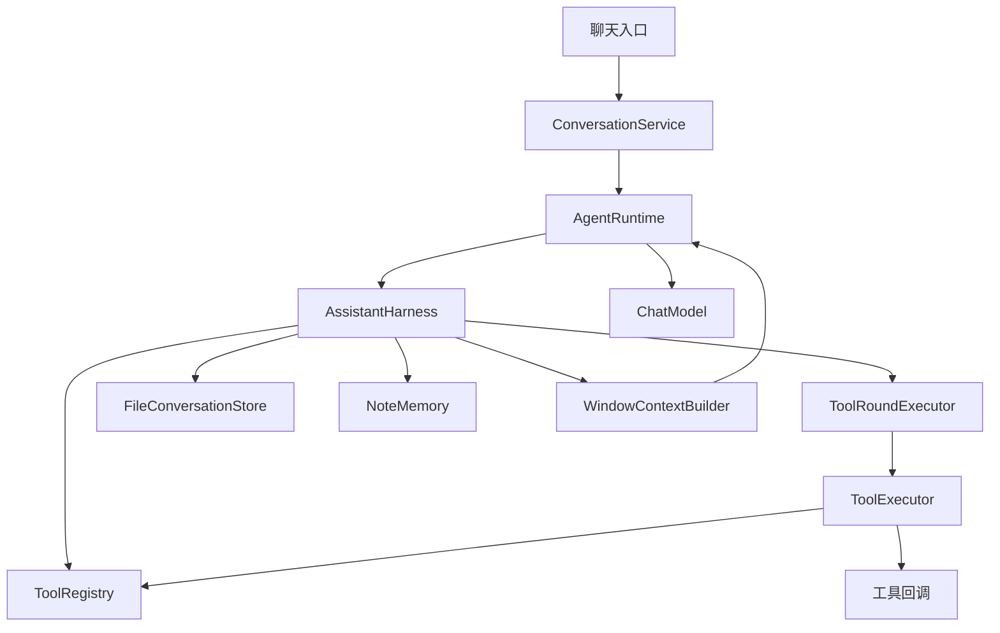

# Personal Assistant

Java 21 + Spring Boot + Spring AI 的个人助手。固定 ReAct / Harness 主链路，模型、工具、记忆、上下文与存储通过组件插入。

陪伴助手的人格、记忆、行为设计与开发记录见 [开发总览](companion-agent/README.md)，当前优先推进 [人格设计](companion-agent/personality/README.md)。

上下文组织的核心准则见 [agent.md](agent.md)；具体组成逐步确定后再按准则组织。

## 启动

启动前设置独立的数据目录。Shell 默认使用 `ubuntu:24.04` 基础镜像，首次创建容器时若本地缺少镜像会自动拉取。项目目录由每次聊天请求的 `projectPath` 提供，CLI 自动携带启动时的当前目录。

```bash
export ASSISTANT_DATA_DIR="$HOME/.personal-assistant-data"
mvn -DskipTests package
mvn spring-boot:run
```

后端默认监听 http://127.0.0.1:18081，通过 `personal-agent-cli` 或下方 HTTP API 连接。当前 YAML 配置为真实模型模式，需要设置 API Key；不依赖 MySQL 或 Redis。

可尝试“你好”，或先发送“记住：我喜欢中文回答”，再询问“你记得什么”。

演示模型用于检查调用链，不具备真实大模型的自由对话能力。

## 注册工具

在 Spring 中注册带执行类型的 `ToolBinding` Bean，默认注册表会接入全部 `ToolBinding` Bean。访问 `GET /api/components` 可以查看注册的工具和模型模式。

内置工具已统一声明为 Bean，包括 `list_files`、`glob_files`、`grep_files`、`read_file`、`write_file`、`edit_file` 和 `execute`。名称重复会导致启动失败。

请求中的项目目录必须与助手数据目录分开，启动示例将数据保存在用户目录下。文件工具从本轮 `ToolContext.projectPath` 取得根目录，不在共享实例中保存项目路径。

`execute` 使用 YAML 中配置的 Linux 镜像，默认 `ubuntu:24.04`，可用 `ASSISTANT_SHELL_IMAGE` 覆盖；实际执行时需要 Docker 可用。镜像需要提供 `/bin/sh` 和 `sleep`；项目依赖可在容器中安装。首次 Shell 调用按规范化项目路径创建容器，本地缺少镜像时自动拉取，拉取与创建共限时 300 秒；将项目目录可写挂载到 `/workspace`，开放容器网络；后续调用通过 `docker exec` 复用容器，已停止时自动启动。命令产生的项目修改会同步到宿主机，容器内安装的依赖在停止后保留。每次调用使用新的 Shell，`cd`、`export` 不会自动延续。超时或取消时停止整个项目容器，下次调用重新启动；执行失败不会回退到宿主机。每个容器限制为 2 核 CPU、1 GiB 内存、禁用 swap、128 个进程/线程；这些是使用上限，不预占全部资源，磁盘空间尚未限制。更换镜像需要手动删除旧容器后重新创建。

## 固定骨架与组件



| 位置 | 职责 |
| --- | --- |
| `core/ConversationService` | 每会话阻塞串行、等待输入与 steer |
| `core/AgentRuntime` | 模型与工具循环、实际请求预算、工具意图检查点顺序 |
| `core/AssistantHarness` | aroundRun / aroundReasoning / aroundModelCall / aroundToolRound、恢复与持久化 |
| `core/AgentExecution` | 每轮的已提交游标、历史/记忆快照和实际请求计数 |
| `component/` | 工具执行器、文件存储、上下文和记忆组件 |
| `extension/`（按需创建） | 自定义组件与工具 Bean |
| `config/` | 启动装配和配置校验 |
| `resources/prompts/assistant/v1.txt` | 默认系统提示词 |

Harness 直接调用 `component/` 里的组件。Spring 在启动时装配它们，同类型的用户 Bean 优先。

每次模型推理前重新调用上下文组件，临时模型视图不修改已保存记录。调用方向为 Controller → ConversationService → Runtime.chat → Harness.aroundRun → Runtime.runLoop；Harness 接收循环的方法引用，不反向依赖 Runtime。每个会话使用公平锁，由请求线程执行自己的消息并等待工具结果。连续的只读工具可在共享线程池并行。

排查问题先按 turnId 查阶段日志：memory.recall → context → model → persistence → tools → memory.observe。职责表和错误处理见 [架构](docs/ARCHITECTURE.md)。日志不保存完整模型输入，也不替代恢复检查点。

开发示例见 [组件开发指南](docs/COMPONENTS.md)。

## 接入真实模型

模型配置统一在 [application.yml](src/main/resources/application.yml) 的 `assistant.model` 中修改，只有 API Key 从环境变量 `AI_API_KEY` 读取：

```yaml
assistant:
  model:
    provider: openai
    api-key: ${AI_API_KEY:}
    base-url: https://ws-34np4pi5koc2utbe.cn-beijing.maas.aliyuncs.com/compatible-mode/v1
    completions-path: /chat/completions
    name: kimi-k3
    reasoning-effort: ""
    timeout-seconds: 60
```

```bash
export AI_API_KEY='填写服务商密钥'
mvn spring-boot:run
```

最终请求地址由 `base-url + completions-path` 组成，避免重复拼接 `/v1`。更换服务商时同步调整地址、路径、模型名和对应密钥。`reasoning-effort` 留空时沿用服务商默认行为。

`ASSISTANT_MODEL_PROVIDER`、`AI_BASE_URL`、`AI_COMPLETIONS_PATH`、`AI_MODEL`、`AI_REASONING_EFFORT` 不再用于模型配置。修改 YAML 后需要重启后端。模型默认连接与响应超时 60 秒，不自动重试。

如需本地演示模式，将 YAML 中的 `provider` 改为 `demo`，无需 API Key。

## 数据与配置

启动、模型连接和执行预算均在 [application.yml](src/main/resources/application.yml) 配置。

| 环境变量 | 默认值 |
| --- | --- |
| `AI_API_KEY` | 无，真实模型模式必填 |
| `ASSISTANT_PORT` | `18081` |
| `ASSISTANT_DATA_DIR` | `./data`，相对于启动目录 |
| `ASSISTANT_MEMORY` | `notes`，可选 `none` |
| `ASSISTANT_SYSTEM_PROMPT` | `classpath:prompts/assistant/v1.txt` |
| `ASSISTANT_SHELL_IMAGE` | `ubuntu:24.04`，本地缺少时自动拉取 |

默认备注记忆只保存以“记住：”或“记住:”开头的消息，按 conversationId 隔离。新对话不读取其他会话备注。关闭长期记忆不删除聊天记录：

```bash
ASSISTANT_MEMORY=none mvn spring-boot:run
```

`data/sessions/` 保存会话 ID、项目路径、标题和创建/活动时间，`data/conversations/` 保存聊天和工具检查点，`data/memory/` 保存显式备注。数据目录已加入 Git 忽略规则。替换记忆实现时，旧数据格式不会自动迁移。

默认上下文最多选择最近 8 个完整成功轮次，历史 24000 字符、记忆 4000 字符。运行消息总上限 64000 字符，每轮最多 12 次模型调用。字符数属于近似预算，未计入服务商协议和工具定义开销。

## HTTP API

```bash
curl http://127.0.0.1:18081/api/chat \
  -H 'Content-Type: application/json' \
  -d '{"conversationId":"my-chat","messageId":"550e8400-e29b-41d4-a716-446655440000","message":"你好","projectPath":"/absolute/path/to/project"}'

curl http://127.0.0.1:18081/api/conversations
curl http://127.0.0.1:18081/api/conversations/my-chat/session
curl http://127.0.0.1:18081/api/conversations/my-chat
curl http://127.0.0.1:18081/api/components
```

聊天请求的 `projectPath` 必须是后端可访问的现有项目绝对目录。第一条开始执行的消息会持久化会话与项目的绑定；后续请求必须使用相同的真实路径，否则返回 HTTP 409，不进入 Agent 执行。同一执行轮次不接受其他项目的消息作为 steer。普通聊天返回 `conversationId、turnId、answer、modelCalls、warnings`。客户端为每条输入生成 messageId，可在执行期间继续发送。

会话恢复使用三个查询接口：

- `GET /api/conversations`：返回全部会话信息，按 `updatedAt` 倒序排列，每条包含 `conversationId、projectPath、title、createdAt、updatedAt`。标题取首条用户消息摘要。
- `GET /api/conversations/{id}/session`：返回指定会话信息，不存在返回 404。查询不会创建内存 Session，也不会执行中断恢复。
- `GET /api/conversations/{id}`：返回按时间排列的全部已保存轮次，包含用户/助手消息、工具调用与结果、轮次状态和失败原因，不受模型上下文裁剪影响。

恢复客户端先取得原项目路径、切换工作目录并展示历史，再使用原 `conversationId` 和 `projectPath` 发送新消息。后端重启后会重新创建内存 Session，由现有 Harness 加载历史、将遗留 RUNNING 标为 FAILED，不重放工具。CLI 的 `agent resume` 命令尚未接入。

旧会话没有保存项目路径，仍会出现在列表中，但 `projectPath` 返回 `null`；查询不会猜测目录或修改旧记录。客户端需要让用户明确指定项目后发送下一条聊天请求，此时绑定该目录。旧会话的活动时间暂取最后轮次开始时间。元数据与轮次使用独立原子文件，不提供跨文件事务；完成后的活动时间更新失败只记录服务日志，不回滚回答。

CLI 可用同样的请求体读取纯文本进度。`-N` 让 curl 收到内容就显示：

```bash
curl -N http://127.0.0.1:18081/api/chat/stream \
  -H 'Content-Type: application/json' \
  -d '{"conversationId":"my-chat","messageId":"550e8400-e29b-41d4-a716-446655440001","message":"你好","projectPath":"/absolute/path/to/project"}'
```

每次实际请求模型时显示调用序号。工具进度包含名称、参数、结果摘要、成功与失败数和批次耗时。流的最后输出回答。如果开始输出后执行失败，错误写在流内；被提升为补充的请求返回空的 HTTP 202。

`POST /api/steer` 接收 `{conversationId,messageId}`，仅把已登记且未执行的普通消息转为当前任务补充。成功返回 STEERED；不能提升时返回 409。被提升的原聊天请求返回 202 STEERED，不再单独执行。客户端通过该接口将等待消息转为当前任务的补充。

Harness 在推理前逐条保存补充，最终文本返回前还会检查剩余补充。补充采用尽力处理语义，极晚到达可能未生效，不自动带入下一轮。记忆故障不会回滚已保存的回答。

## 恢复与边界

- 单轮状态为 `RUNNING → COMPLETED / FAILED`。
- 工具意图保存成功后才执行；重启后的未完成轮次保留为失败记录，不自动重放。
- 成功轮次恢复完整工具配对；上下文裁剪不删除原始记录。
- 新记录使用 `schemaVersion=3`，历史格式 `1` 和 `2` 仍可读取。
- 当前为单进程、同一会话串行、本地原子文件替换；两个进程不能共用数据目录。
- 默认仅监听 127.0.0.1。身份授权、SSE、跨会话记忆、后台任务和动态热加载尚未实现。

详见 [架构](docs/ARCHITECTURE.md) 与 [后续事项](docs/ISSUES.md)。

## 轻量检查

默认只做编译和与本次变动有关的小检查，不启动浏览器或访问外部模型。

```bash
mvn -DskipTests compile
mvn -Dtest=WorkspaceToolsTest,ComponentWiringTest test
```

已有其他测试保留为按需入口，不默认执行完整测试集。

项目固定使用 Spring AI 1.1.8；[手动工具执行文档](https://docs.spring.io/spring-ai/reference/1.1/api/tools.html#_user_controlled_tool_execution) 是模型工具协议参考。

本地演示模型每次调用等待 3 秒。连续发送 A、B、C 可观察顺序执行；A 尚未结束时，将 C 点为“转为补充”，C 会在后续推理边界加入 A，B 仍在 A 结束后独立执行。应用补充会再次调用模型，因此 A 可能超过 3 秒。
